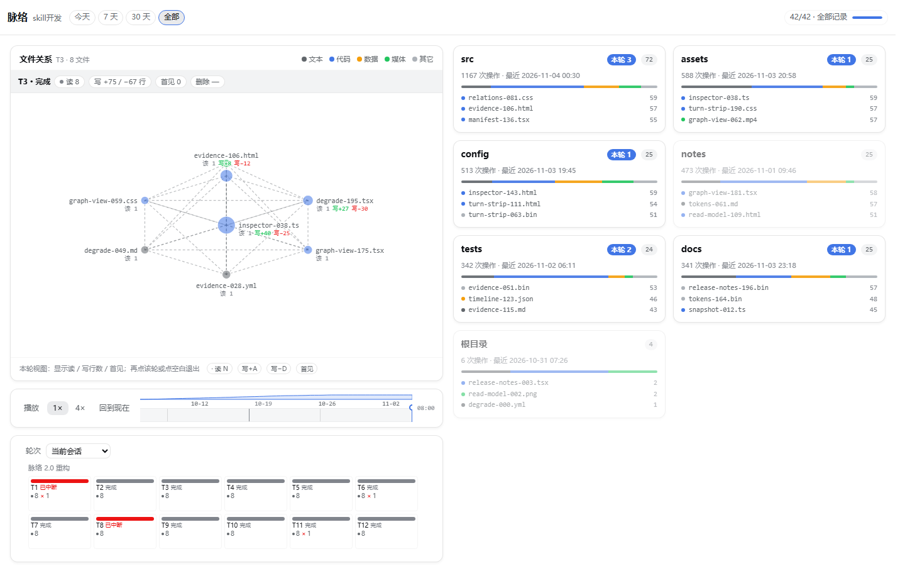

<p align="center">
  
</p>

<h1 align="center">Threadline · 脉络</h1>
<p align="center">A permanent read-only visual map of how a DeepSeek Harness workspace actually developed.</p>
<p align="center"><a href="README.zh.md">中文</a></p>
<p align="center">
  <a href="https://www.typescriptlang.org/"></a>
  <a href="https://react.dev/"></a>
  <a href="https://github.com/deepseek-ai/deepseek-harness"></a>
  <a href="LICENSE"></a>
  <a href="CHANGELOG.md"></a>
</p>

## Overview

Threadline answers a question that chat logs do not: **what did this workspace actually go through, and what did each turn change?**

It reads what DeepSeek Harness has already recorded — sessions, subagents, tool calls, file operations, commands, background jobs — and turns it into a growing relationship map of the current workspace. Files that DSH touched become nodes, grouped by directory; turns become a strip at the bottom; every number can be traced back to a recorded event.

It is **permanently read-only**. It never writes to your workspace, your session logs or your settings, never calls a model, and never makes an outbound request. It cannot start, stop or retry anything — there is deliberately no control surface at all.

Typical use: you come back to a long session, or hand a workspace to someone else, and want to see where the work went.

## Features

- **File relation map (left)** — the most active directory of the current session by default. Pick any directory card to switch; pick a turn to switch to the files touched by that turn across directories. Deterministic radial layout, no pan/zoom, no cluster boxes, no grid. Node colour = five file families (text / code / data / media / other).
- **Directory cards (right, two columns)** — name, file count, current-turn badge, operations / last activity, five-family bar, top 3 active files. Same screen as the map, one page scroll; stacks below 960px.
- **Turn status only from recorded facts** — `read N`, `write +A / −D lines`, `first seen`; file-level deletion/creation is not provable and is not shown. The summary bar is fixed to one line: `read N · write +A/−D lines · first seen F · deletes C` (full wording in the tooltip).
- **Two-way hover linking** — hover a card to preview its directory; hover a node to highlight its directory card and related turns; hover a turn to preview that turn's files and highlight related cards. Hover only previews; it never changes the click selection or scroll position.
- **Per-turn impact icon** — under a finished assistant message; click jumps to the Threadline tab and focuses that turn, with no dialog.
- **`/threadline` command** — a shortcut to the tab (focuses the current session); the old dialog is gone.
- **Privacy mode / list view / progressive load / honest by design** — unchanged from 1.0: paths and titles can be masked; file and turn tables are keyboard-accessible; unloaded, failed and unobserved are labelled instead of replaced with 0 or an empty state.

## Installation

Requirements: DeepSeek Harness **0.2.2-rc.1** or newer, on a desktop or web profile.

Install it as a DSH plugin from npm:

```text
Plugin manager → Add plugin → dsh-plugin-control-your-development@1.0.0
```

Or install into a profile directly:

```bash
dsh plugin add dsh-plugin-control-your-development@1.0.0 --profile desktop
```

Then reload the page (client code) or restart DSH (host code).

> Installed DSH plugins do not update automatically. Upgrading means uninstalling and installing the new version — this is a DSH behaviour, not a Threadline one.

## Usage

Open a conversation and pick the **Threadline** tab next to chat / trajectory. The tab fills the conversation area and scrolls on its own; the composer is hidden while you are in it and returns when you leave.

<p align="center">
  
</p>

- The left map shows the current directory; pick another directory card to switch, or a turn block to switch to that turn's file map with status.
- Hovering a card, node or turn previews and cross-highlights; clicking pins the selection; leaving the whole tab restores it.
- The timeline plays the workspace back in time; ranges are **today / 7 days / 30 days / all**.
- `/threadline` jumps to the tab; the per-turn impact icon jumps and focuses that turn.

<p align="center">
  
</p>

Threadline only reads the workspace the current session belongs to. Sessions from other workspaces, profiles or machines are not aggregated.

## Configuration

None. There is no configuration file, no setting, no stored preference and no cached artefact — all filters, selections and time ranges live in memory and reset when you reload. The only thing it needs is the workspace it is already in.

## Project structure

```text
plugin/
  src/shared/      event reducer, relation engine, reference parsers
  src/host/        read-only scan, in-memory index, local read-only routes
  src/client/      data layer, UI, three entries
  lib/             build output loaded by DSH (do not edit)
  tests/           unit, integration and screenshot harness
```

## Releases

Current release: **panel plugin v1.0.0** (stable).

See [CHANGELOG.md](CHANGELOG.md) for what changed in each version, and the [Releases](https://github.com/HaoyanZhang123/dsh-plugin-control-your-development/releases) page for installable versions.

## License

[MIT](LICENSE)
