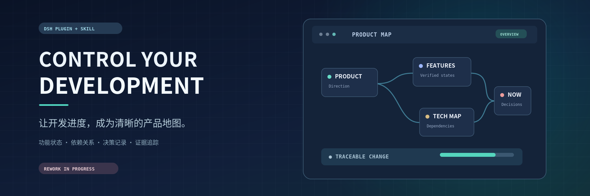
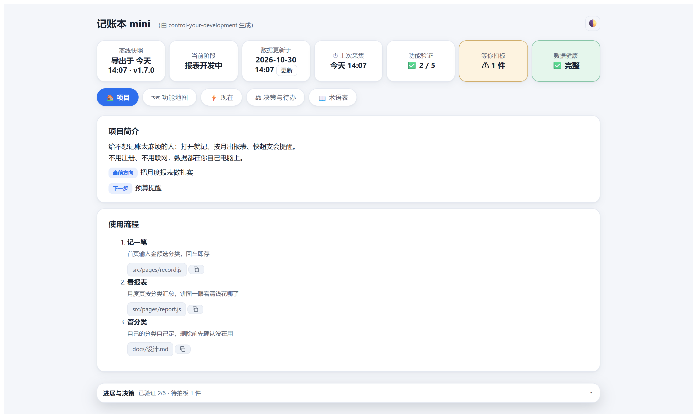
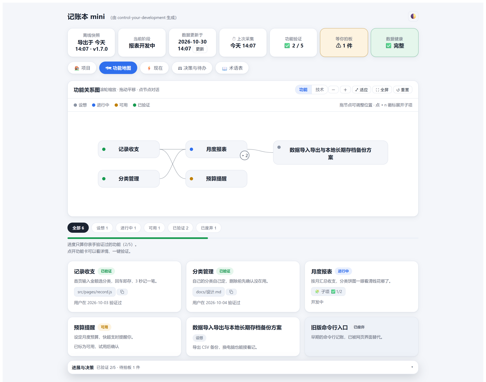
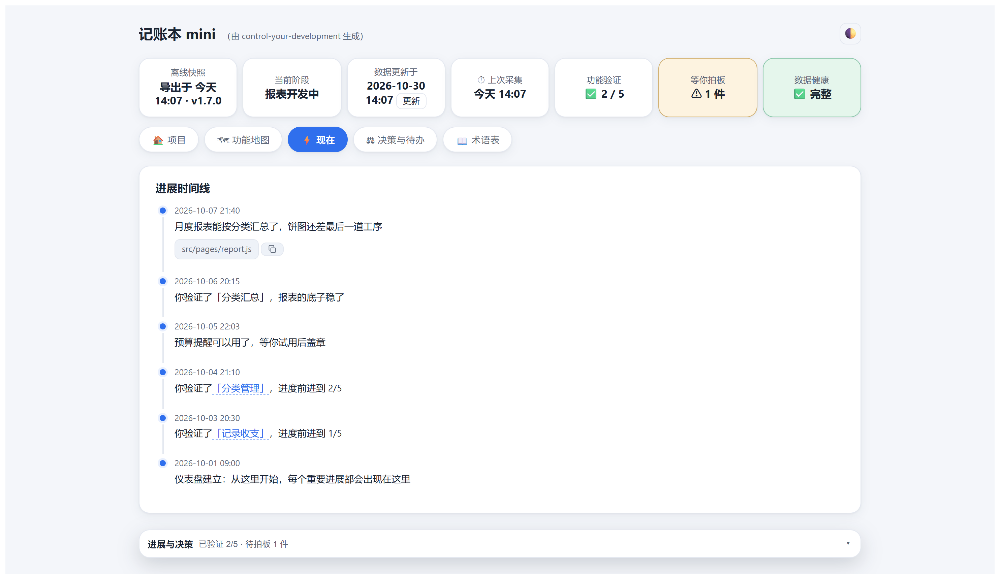
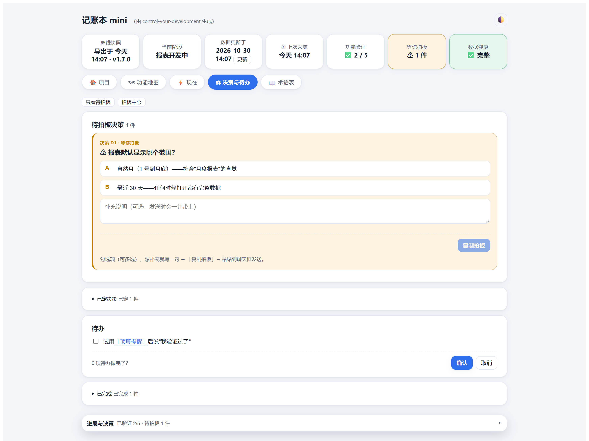
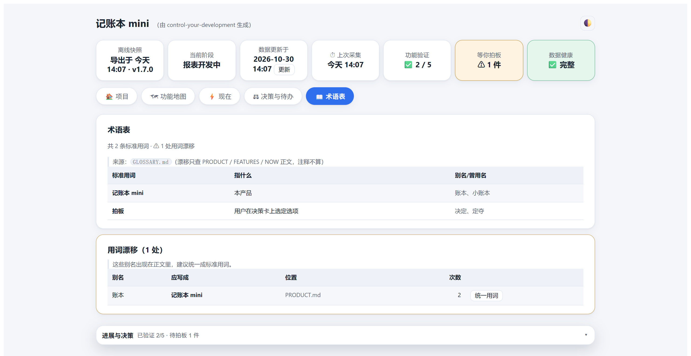

<p align="center">
  
</p>

<h1 align="center">control-your-development</h1>
<p align="center">Turn the development process into a product dashboard you can actually read and control.</p>
<p align="center">A DSH plugin + skill · npm <code>dsh-plugin-control-your-development</code> · <a href="README.zh.md">中文</a></p>
<p align="center">Plugin <code>0.7.0</code> · skill <code>1.7.0</code> · DSH <code>&gt;=0.2.0-0</code></p>

> **Note from the maintainer:** This version is not very usable yet — please hold off on installing the plugin for now. I will refactor a more usable version later. Thanks for your support!

<p align="center">
  <a href="https://deepseek.com/harness/"></a>
  <a href="https://www.npmjs.com/package/dsh-plugin-control-your-development"></a>
  <a href="https://github.com/HaoyanZhang123/dsh-plugin-control-your-development/releases"></a>
  <a href="LICENSE"></a>
  <a href="https://www.python.org/"></a>
  <a href="https://commonmark.org/"></a>
</p>

<p align="center">
  <a href="#overview">Overview</a> ·
  <a href="#features">Features</a> ·
  <a href="#installation">Installation</a> ·
  <a href="#usage">Usage</a> ·
  <a href="#repository-layout">Repository layout</a> ·
  <a href="#releases">Releases</a> ·
  <a href="#license">License</a>
</p>

## Overview

You are building a product with AI, but code, commits and terminals are not the language you think in. **control-your-development** keeps the project's own story in human-readable Markdown — what the product does, where each feature stands, what changed and what is waiting for your call — and renders it as a dashboard that stays inside DSH. The AI maintains the Markdown; you read the dashboard and make decisions.

It ships as a DSH **skill** plus an optional **panel plugin**. The skill teaches the AI to set up and maintain `dev-dashboard/`; the plugin pins the dashboard in the right sidebar and adds a full-page map view on top of the conversation. All views render from one fingerprinted read model (`.view.json`), so they show the same data for the same source state; an exported snapshot is frozen at its export time.

## Features

- **Markdown as the single source of truth.** `PRODUCT.md` (what it is, who it is for, where it is heading), `FEATURES.md` (state, evidence and dependencies per feature), `NOW.md` (timeline, decisions and to-dos), plus `GLOSSARY.md`, `TECH.md` and `CHANGES.md` created by default. `index.html` and `.view.json` are machine artifacts — never edited by hand.
- **Progress you define.** Every feature moves through Idea → In Progress → Usable → Verified. The AI may mark a feature Usable at most; Verified only happens when you say so, and the progress bar counts verified features only. Revoking verification, rework and deprecation are recorded in the timeline.
- **A unified workspace (v0.7.0).** Five tabs — Project, Feature Map, Now, Decisions & To-dos, Glossary — plus a right-side context inspector (what it is / why / where the evidence is / what you can do) and a collapsible progress-and-decisions drawer at the bottom.
- **Feature map and tech map.** Five-state cards, dependency edges, collapsible sub-items, wheel zoom, drag-to-pan, fit-to-screen and a real fullscreen view. The toolbar switches to a Tech view that lays modules out by layer and draws dependencies; links to modules that do not exist yet are drawn as broken stubs.
- **Whole-chain focus.** Hovering or keyboard-focusing a node previews its ancestors and descendants; clicking pins the focus. Only opacity changes — no node positions move.
- **Decisions that reach the AI.** Select options (multi-select is allowed), add a note and press Send — the decision goes straight into the current session. If the session is offline it is queued in `dev-dashboard/.inbox.jsonl` and picked up at the next update, and every decision saves a version snapshot you can compare or restore from.
- **Run controls scoped to the current session.** Stop the current turn (the queue is kept), stop and clear the queue (with a confirmation), or retry the last message. The run status is a read-only projection of the session; when it cannot be observed the UI says so instead of guessing.
- **One fingerprinted read model.** The renderer writes `dev-dashboard/.view.json` atomically with `sourceHashes`; the panel and the offline page only consume it. If the model is stale, the old map stays visible and is labelled, and actions that depend on stale context are disabled. If the dashboard was written by a newer plugin, it is treated as read-only instead of being silently misread.
- **Honest by construction.** Every code change must be included in the dashboard or explicitly ignored — silent omission is rejected. Missing evidence files and unfiled facts fail the render loudly, and the tech map announces modules whose evidence no longer exists.
- **A single-file offline snapshot.** Say "export the web version" to get one `index.html`: zero dependencies, zero network, light/dark adaptive and print-friendly. Since v0.7.0 it is a **read-only snapshot** labelled with its export time and source version — there is no folder permission prompt and no write-back.
- **No code changes to your project.** It reads change records and writes only inside `dev-dashboard/`. Git is optional — without git it falls back to file modification times and labels the source.

## Installation

**Prerequisite:** DSH desktop. DSH is in preview and its plugin APIs are still evolving.

1. Open **DSH → Plugins → Add plugin**.
2. Enter the npm package name:

   ```
   dsh-plugin-control-your-development
   ```

3. The plugin activates and installs the bundled skill into the global skills directory (`<dshHome>/skills/`), so every workspace can use it.

Installing from npm needs neither git nor GitHub access; in mainland China the registry mirror is used automatically. Other paths:

| What | How |
|---|---|
| Plugin + skill (recommended) | DSH → Plugins → Add plugin → `dsh-plugin-control-your-development` |
| Skill only, no panel | Copy `skill/control-your-development/` into `.dsh/skills/` of your project (create the directory first) |
| Offline / another machine | Get the tarball from the npm registry (`https://registry.npmjs.org/dsh-plugin-control-your-development/-/dsh-plugin-control-your-development-0.7.0.tgz`), move it over, then Add plugin with its **absolute path** |

Compatibility: the plugin declares `>=0.2.0-0` for its DSH peers and has been installed on DSH `0.2.1-rc.2` on Windows; macOS and Linux use the same code paths, but no real-machine run for v0.7.0 is recorded. DSH does not auto-update installed plugins: to upgrade, uninstall the old version, add the plugin again, then refresh the page or restart DSH.

Full details — global skill install, offline install, uninstall and upgrade: [`INSTALL.md`](INSTALL.md).

## Usage

1. Open your project in DSH.
2. Say **"control my development"** (or "set up a development dashboard for me"). The AI creates `dev-dashboard/` with the Markdown files, renders the first dashboard and starts a file watcher.
3. The sidebar panel shows the dashboard of the **workspace you have open**; switch projects and it follows. For a workspace without a dashboard, the panel offers a button that asks the AI to set one up.

Then drive everything in plain language:

| You say | What happens |
|---|---|
| "control my development" | The dashboard is initialized in the current project |
| "This phase is done — update the dashboard" | Changes are collected, the Markdown is updated and re-rendered; the panel refreshes |
| "Decision D1: A and C" (or send it from the panel) | Your call is recorded, a version snapshot is saved, and work continues |
| "I have verified the expense logging feature" | The feature is marked Verified and the progress bar moves |
| "Save a version" | The current Markdown is saved as a snapshot you can compare or restore |
| "Export the web version" | A single-file `index.html` snapshot is written next to the dashboard |

### What it looks like

These are snapshots of the **offline dashboard** for a demo project; the sidebar panel renders the same core UI, with host-only additions such as the full-page map and current-session run controls. The dashboard's interface copy is currently Chinese; the panel's name and description follow the DSH app locale.

**Project** — one-line positioning, direction and next step, the control strip, and the real usage flow.



**Feature Map** — five-state cards, dependencies and collapsible sub-items.



**Now** — the timeline of what happened.



**Decisions & To-dos** — pending decisions, settled decisions and open to-dos.



**Glossary** — standard terms, and terminology drift found in the body text.



The dashboard is always regenerated from the Markdown source of truth. Hand edits to `index.html` or `.view.json` are overwritten; to change content, change the Markdown or tell the AI what should change.

## Repository layout

```
dsh-plugin-control-your-development/
├─ package.json / cordis.patch.yml   ← panel manifest (the repo root is the plugin package)
├─ lib/ src/ tools/                  ← browser bundle / source / build script
├─ skill/control-your-development/   ← the capability itself
│  ├─ SKILL.md / manifest.yaml       ← skill definition
│  ├─ static/                        ← the AI's working discipline and workflow
│  ├─ templates/                     ← Markdown templates and the shared render core
│  ├─ scripts/                       ← render / collect / watch (Python standard library)
│  └─ references/                    ← data format, copy deck and design tokens
├─ docs/images/                      ← cover and dashboard screenshots
└─ INSTALL.md / CHANGELOG.md
```

## Releases

The current release is **v0.7.0**; the changelog is in [`CHANGELOG.md`](CHANGELOG.md) and release notes for every version live on the [Releases page](https://github.com/HaoyanZhang123/dsh-plugin-control-your-development/releases). Upgrading requires uninstalling the old plugin and adding the new version, then refreshing the page or restarting DSH.

## License

[MIT](LICENSE) © 2026 dsh-plugin-control-your-development contributors. Questions and suggestions are welcome through GitHub Issues.
