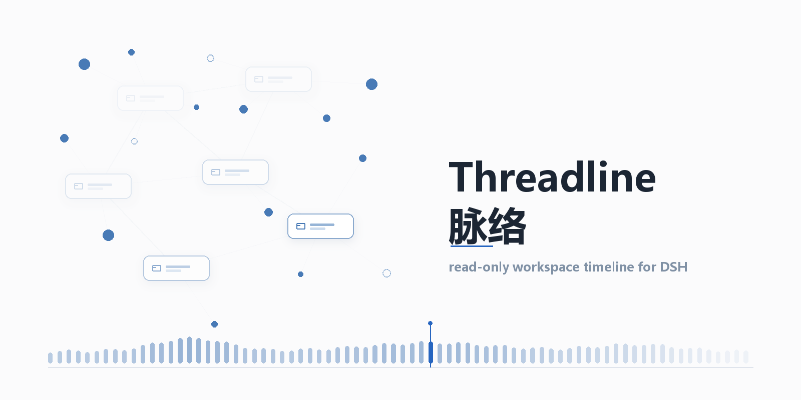
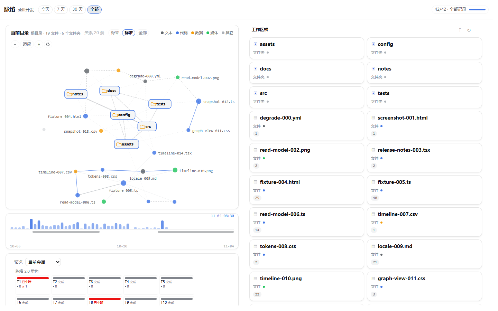
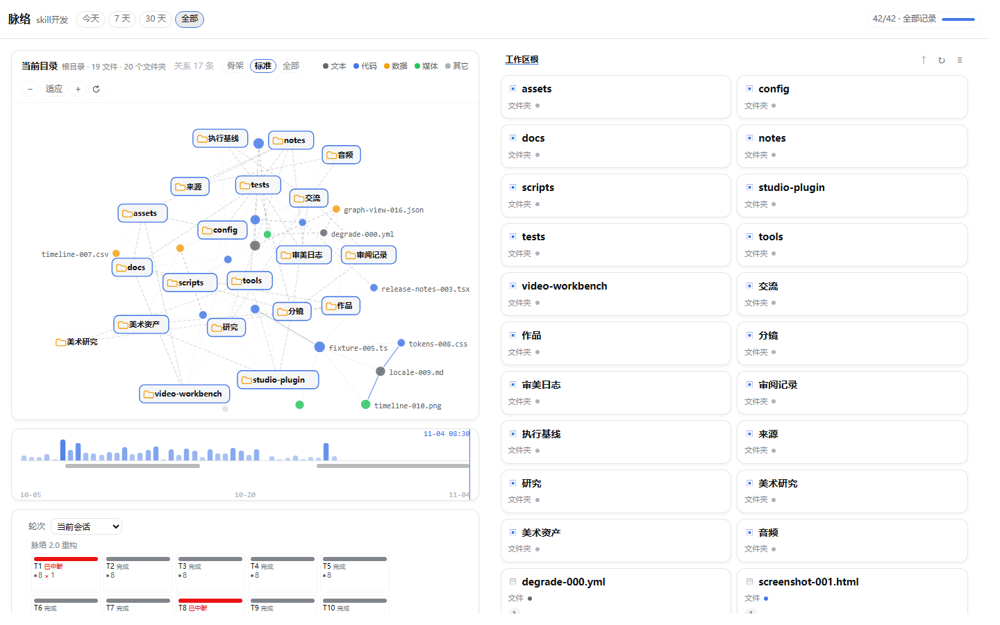
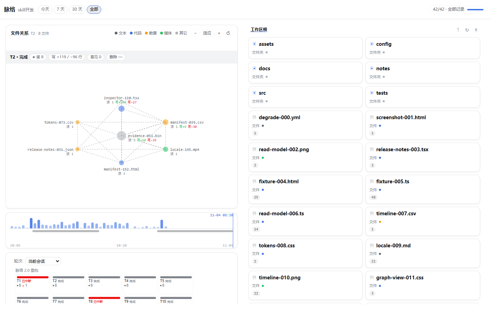
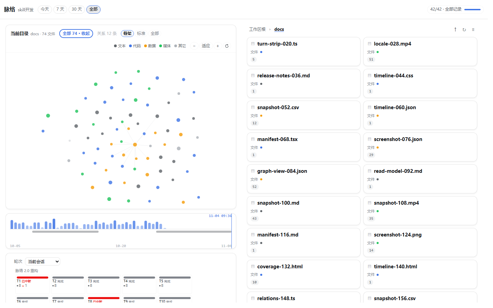
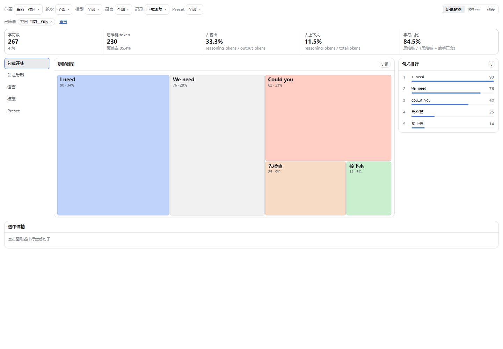
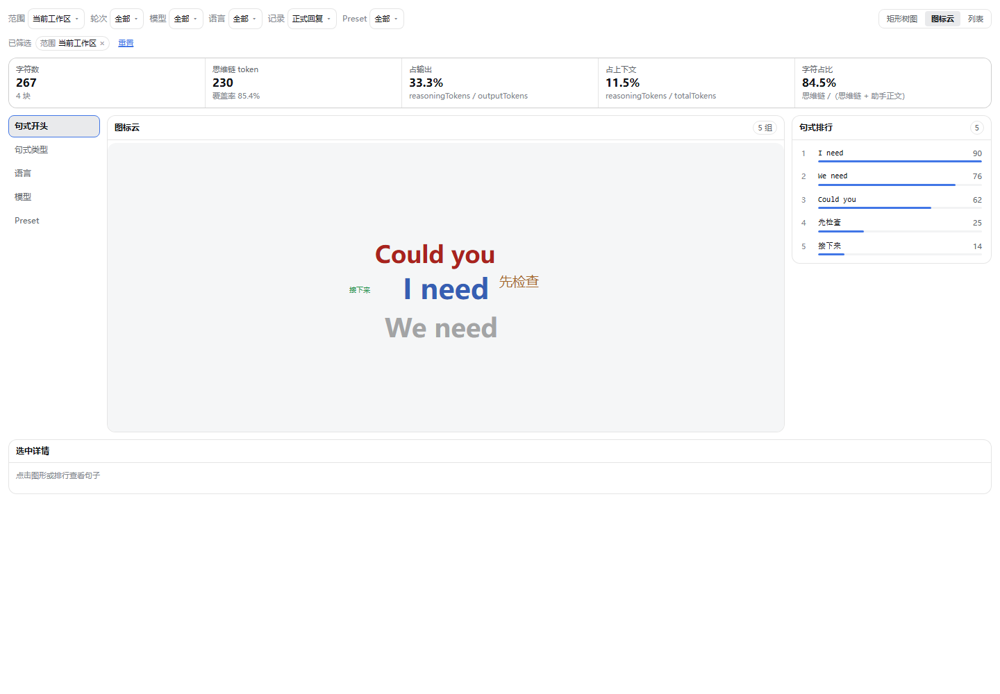
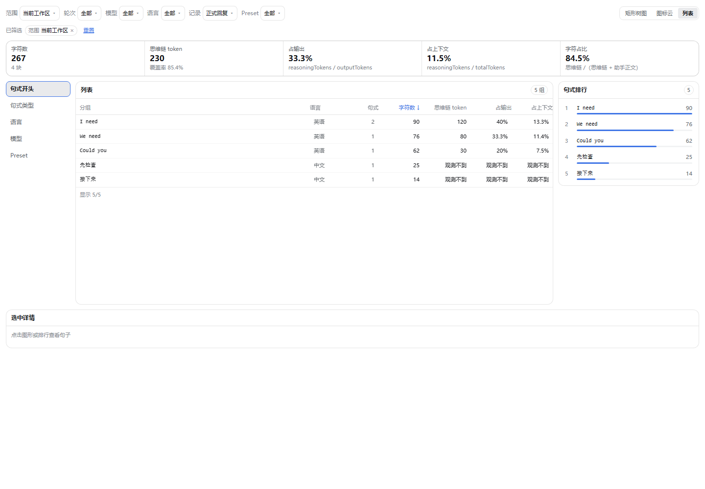

<p align="center">
  
</p>

<h1 align="center">Threadline / 脉络</h1>
<p align="center">A read-only DSH plugin that turns what a conversation did to your workspace into a drillable timeline.</p>
<p align="center"><a href="README.zh.md">中文</a></p>

<p align="center">
  <a href="https://nodejs.org/"></a>
  <a href="https://www.typescriptlang.org/"></a>
  <a href="https://react.dev/"></a>
  <a href="https://esbuild.github.io/"></a>
  <a href="https://www.npmjs.com/package/dsh-plugin-control-your-development"></a>
  <a href="LICENSE"></a>
</p>

## Overview

Threadline is a plugin for [DeepSeek Harness](https://github.com/deepseek-ai) (DSH) that answers a
narrow question well: **what did this conversation actually change in my workspace?**

It collects the files a turn touched, the commands it ran, the subagents it spawned and the relations
between turns, then presents them as one drillable timeline embedded in the DSH session view. Everything
is **read-only**: the plugin never writes to your workspace, never stores anything, never opens an extra
entry point.

It is built for people who let an agent work in a repository and then need to review the result — not for
planning, task assignment or code editing.

## Features

- **Relation graph of the current directory.** A deterministic force-directed layout where folders are
  rounded cards and files are dots. Edges are layered (skeleton, top-3 co-occurrence, the rest on hover),
  capped at `1.6 ×` node count so the graph never turns into a spider web.
- **Folder-to-folder links.** Aggregated from real cross-directory relations only. Folders with no real
  relation go to a perimeter ring and are never connected by a fabricated edge.
- **Node cap with an honest switch.** Up to 40 files by default; a persistent `Show N/M` chip switches to
  the full set in place and auto-degrades density, labels and radius. Hard ceiling 300.
- **Dual-track timeline.** An activity histogram per time bucket on the upper track, one row per session on
  the lower track, a single playhead label, and exactly three scale ticks.
- **Turn strip with lock-first selection.** Click a turn to lock it, hover another turn without losing the
  lock, click again to release. Double-click the timeline to snap back to "now".
- **Workspace file browser.** Starts at the workspace root, navigates to any depth, breadcrumb / back /
  refresh, card or list view, virtualization beyond 200 rows.
- **Zero third-party runtime dependencies.** `dependencies` is an empty object; React and `@deepseek-ai/*`
  are peer dependencies provided by the host.

## Installation

Threadline is a DSH plugin. Install it through the DSH plugin manager, or with npm:

```bash
npm install dsh-plugin-control-your-development
```

Requirements:

- DSH with runtime `0.2.1-rc.5` or later (`@deepseek-ai/dsh-session >= 0.2.0-0`)
- React 18 and React DOM 18 provided by the host (not bundled)

Restart DSH after installing or replacing the package. Replacing an already-loaded plugin requires a
process restart; a page refresh alone does not reload it.

## Usage

Three surfaces, no fourth entry point:

| Surface | Where | What you get |
| --- | --- | --- |
| **Threadline tab** | `conversation.view`, id `threadline` | Left column: relation graph of the current directory + dual-track timeline + turn strip. Right column: workspace file browser. Both columns scroll independently. |
| **Impact count** | assistant message actions, id `threadline-impact` | Files / commands / subagents touched by that turn. Clicking jumps to the Threadline tab focused on that turn — no dialog. |
| **`/threadline`** | input box command (also `/脉络`) | Jumps to the Threadline tab for the current session. |



Typical flow:

1. Open a session and switch to the **Threadline** tab.
2. The left graph shows the current directory. Click a folder card to enter it; the right column follows.
3. Hover a file to highlight its relations; click to pin the evidence panel.
4. Click a turn in the strip to lock that turn's file graph. Click it again to release.
5. Drag a folder card or a file dot to rearrange. Use `Fit` to reset the camera and `Reset` to clear drags.

### Folder-to-folder links

A directory with many subfolders is not a scatter of isolated cards: folders that really exchanged
files are connected, so you can see which parts of the workspace move together.



### One turn in isolation

Clicking a turn switches the left graph to that turn's files and overlays the read / write line counts.



### Node cap

Directories with more than 40 files keep the most active ones and show a persistent `Show N/M` chip.
Switching to the full set degrades density, labels and radius automatically.



> The screenshots above are rendered from the real component with a synthetic fixture dataset, so the
> file names are test data; the interface itself is not a mock-up.

## The Reasoning tab

A second tab, **Reasoning**, answers a different question about the same conversation: **how much thinking
went into it, and of what kind?** It reads the `reasoning` blocks DSH already records, so it adds no
execution cost and no writes.

Three views share one selection, one KPI strip and one detail band — switching views never changes the
page height:

| View | What it shows | Best for |
| --- | --- | --- |
| **Treemap** | True squarified layout, area = characters. Up to 12 cells; the rest merge into an "Other" cell you can drill into. Each cell clips its own label, so long phrases never bleed into a neighbour. | Seeing which groups dominate at a glance |
| **Word cloud** | Text as the graphic, sized by weight. Two-phase layout: canvas `measureText` first, then deterministic spiral placement with collision detection. Words that do not fit are counted, never silently dropped. | Scanning vocabulary |
| **List** | Sortable table with ratio bars. Group and sentence rows are paged, so a dimension with tens of thousands of groups still renders instantly. | Auditing exact numbers |



### Filters that actually filter

Six controls, and every one of them changes the derived data:

- **Scope** — current session (default), unarchived sessions, or the whole workspace.
- **Turn** — a single turn, or all turns. The turn list is enumerated from the data, not hard-coded.
- **Model** and **Preset** — enumerated from the samples that actually exist.
- **Language** — applied at sentence level, because language is a per-sentence property; filtering it at
  sample level would invent a second definition.
- **Records** — committed replies only, or include interrupted attempts.

An **active-filter row** appears only when something is filtered, names each condition, and offers a
one-click reset. An empty result says *which* conditions produced it rather than claiming there is no data.

### Honest numbers

The three ratios have three different denominators, and the UI labels each one:

| Figure | Definition |
| --- | --- |
| **Share of output** | `reasoningTokens / outputTokens` — how much of the reply's output was thinking |
| **Share of context** | `reasoningTokens / totalTokens` — how much of the whole context (including input and cache) was thinking |
| **Character share** | reasoning characters / (reasoning + answer text). Shows `—` when a scope has no answer text at all, instead of reporting an inflated percentage |

Provider usage is reported **per reply**, not per sentence. So group-level token counts are distributed by
character share within that reply — the columns sum back to the true total, and the UI marks the value as an
estimate rather than pretending to sentence-level precision.





### Cost and coverage

The first open reads the current session plus the four most recently updated sessions. That is deliberate —
reading every log in a large workspace costs seconds. When the scope is wider than what is loaded, the page
shows **"loaded N/M sessions"** with a failure count and explicit *load more* / *load all* actions, so a
partial sample is never presented as a full-workspace statistic.

## Configuration

No configuration is required. The plugin reads the session's working directory from DSH and needs no
environment variables, tokens or storage paths.

## Project structure

```
plugin/
  src/host/       read-only directory listing, routes, session scan
  src/client/     UI: graph, timeline, turn strip, file browser, inspector
  src/shared/     relation model, path utilities, parsers
  lib/            build output (generated; never edit by hand)
  tests/          node --test suites and browser harness
```

## Project status

> **v1.5.6 is the default version on npm (`latest`) and is still being iterated on.**
>
> It works, but a few things are worth knowing up front:
>
> - **The Reasoning tab is functionally complete.** Treemap / word cloud / list, and all six filters
>   (range, turn, model, language, record, preset) genuinely change the derived data. The language and
>   preset filters actually take effect, and the page honestly reports "loaded N/M sessions".
>   List rows are paged rather than rendered all at once. Visuals and interaction will keep being adjusted.
> - **"Standalone page" is a visual claim, not an architectural one.** A DSH UI plugin can only
>   register into an existing slot (this one uses `conversation.view`); there is no public API for
>   opening an independent window or route. The Reasoning tab fills the area, has an opaque
>   background and scrolls internally, but it is **still rendered inside the conversation container**.
> - **Performance** only gained an "unchanged log is not re-read" cache. The first open still pays a
>   full scan; going further needs incremental log reading, which conflicts with this project's
>   "permanently read-only" rule — not decided yet.
> - **Upgrades are not automatic.** An already-installed copy must be uninstalled and reinstalled to
>   pick up a new version (host limitation).
>
> For concrete problems, please file an issue with the scenario.

## Releases

Current release: **panel plugin v1.5.6** (npm `latest`, actively being polished).

> **v1.5.6**: bug-fix release on top of 1.5.5. The graph no longer flashes twice on load — it used to
> paint once with a fallback canvas size and then re-lay out at the real size, which read as two separate
> entrances (the measurement now happens before paint). The Reasoning tab no longer renders blank: its
> view-entrance animation used `fill-mode: both` with a zero-opacity start frame, so any frame in which the
> animation did not advance left the whole layer invisible. Treemap geometry was also corrected so the
> `viewBox` matches the content box instead of double-subtracting padding. The README now documents the
> Reasoning tab with real screenshots.
> v1.5.5 was the structural pass: both tabs share a single `ConversationSurface` (the Reasoning tab no
> longer leaks the host input box); Threadline collapses nodes, folder cards, icons, labels and all three
> edge classes onto **one rAF geometry clock**, with edge endpoints derived per frame from the current node
> coordinates — the separate `edgeSync` interpolation path is gone. The language and preset filters now
> really feed the derivation pipeline; the treemap is a true squarified layout with per-cell clipping,
> key-stable colors and a drillable "Other"; the word cloud measures text on a canvas and detects
> collisions; lists are paged.
> v1.5.4 fixed eight items from real-device feedback (per-frame edge interpolation, node entry animation,
> the Reasoning tab filling the host area, a muted pastel palette, a real word cloud, the model filter
> enumerating real sample values instead of hard-coded names, the layout rework, and treemap Top 50).
> v1.5.3 fixed the rail list tail misalignment, added layout transitions, colored the treemap and capped
> it at Top 10, and gave host `/detail` an `updatedAt` cache hit.
> See the 1.5.6 / 1.5.5 / 1.5.4 / 1.5.3 / 1.5.1 sections in [CHANGELOG.md](CHANGELOG.md).

- Changelog: [CHANGELOG.md](CHANGELOG.md)
- GitHub Releases: https://github.com/HaoyanZhang123/dsh-plugin-control-your-development/releases

## License

MIT — see [LICENSE](LICENSE).
