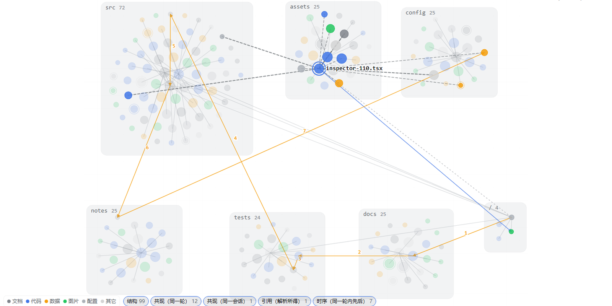
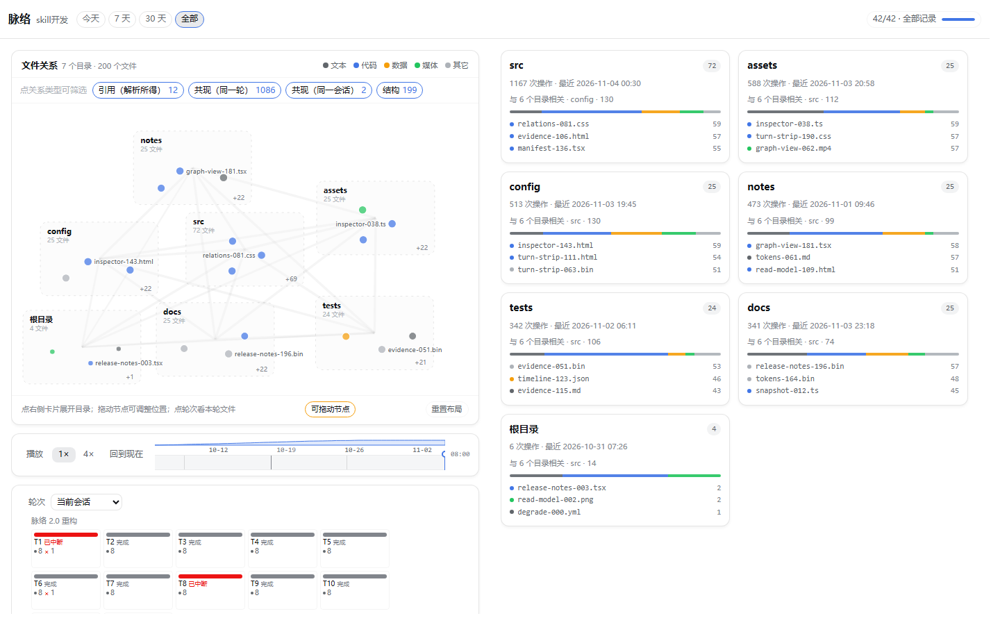
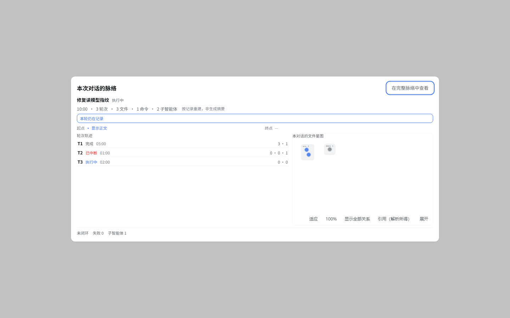

<p align="center">
  
</p>

<h1 align="center">Threadline · 脉络</h1>
<p align="center">A permanent read-only visual map of how a DeepSeek Harness workspace actually developed.</p>
<p align="center"><a href="README.zh.md">中文</a></p>
<p align="center">
  <a href="https://www.typescriptlang.org/"></a>
  <a href="https://react.dev/"></a>
  <a href="https://github.com/deepseek-ai/deepseek-harness"></a>
  <a href="LICENSE"></a>
  <a href="CHANGELOG.md"></a>
</p>

## Overview

Threadline answers a question that chat logs do not: **what did this workspace actually go through, and what did each turn change?**

It reads what DeepSeek Harness has already recorded — sessions, subagents, tool calls, file operations, commands, background jobs — and turns it into a growing relationship map of the current workspace. Files that DSH touched become nodes, grouped by directory; turns become a strip at the bottom; every number can be traced back to a recorded event.

It is **permanently read-only**. It never writes to your workspace, your session logs or your settings, never calls a model, and never makes an outbound request. It cannot start, stop or retry anything — there is deliberately no control surface at all.

Typical use: you come back to a long session, or hand a workspace to someone else, and want to see where the work went.

## Features

- **Workspace star map** — files DSH actually touched, clustered by directory; node size follows operation count, colour follows file family. Up to 600 active files are rendered, and the UI says so when it collapses the rest.
- **Four relation layers** — structure, co-occurrence (same turn / same conversation), reference (parsed from file text) and sequence (order inside one turn). Co-occurrence is never presented as a dependency, and unconfirmed references are listed instead of drawn.
- **Turn strip** — every turn of a session with status, duration, file / command / error / subagent markers. The turn that is still recording is labelled as such.
- **Three inspectors** — file, turn and session, each showing the recorded evidence behind the number, plus later touches and a comparison with the previous turn.
- **`/threadline` command** — rebuilds one conversation as structure: start, end, turn trail, the files it touched, and what is still open.
- **Per-turn impact** — a single icon next to each finished assistant message; it opens the impact of that turn and can jump into the full map.
- **Privacy mode** — metadata first, content folded by default; privacy mode masks paths to basenames, commands to program names and titles to session numbers.
- **List view** — the same data as keyboard-navigable file and turn tables, for accessibility and for reading instead of scanning.
- **Progressive load** — the plugin starts scanning the current workspace as soon as it loads and keeps updating incrementally, so the tab is already populated when you open it.
- **Honest by design** — not loaded, failed to read, not observed and estimated are all shown as such; nothing is replaced by `0` or an empty state.

## Installation

Requirements: DeepSeek Harness **0.2.2-rc.1** or newer, on a desktop or web profile.

Install it as a DSH plugin from npm:

```text
Plugin manager → Add plugin → dsh-plugin-control-your-development@1.0.0-alpha.1
```

Or install into a profile directly:

```bash
dsh plugin add dsh-plugin-control-your-development@1.0.0-alpha.1 --profile desktop
```

Then reload the page (client code) or restart DSH (host code).

> Installed DSH plugins do not update automatically. Upgrading means uninstalling and installing the new version — this is a DSH behaviour, not a Threadline one.

## Usage

Open any conversation and pick the **脉络 / Threadline** tab next to 对话 / 轨迹. The tab fills the conversation area and scrolls on its own; the composer is hidden while you are in it, and comes back when you leave.

<p align="center">
  
</p>

- Click a node to fix the selection: its neighbours stay lit, everything else fades, the inspector shows that file. `Esc` steps back out.
- Pick a turn in the strip to highlight the files that turn touched; the inspector switches to that turn.
- The timeline plays the workspace back in time; ranges are **today / 7 days / 30 days / all**.

Two smaller entries use the same data:

- **`/threadline`** in the composer opens **本次对话的脉络** — the same conversation rebuilt as start → turn trail → end, with the files it produced and what is still open.
- The **impact icon** under a finished assistant message opens that single turn's impact.

<p align="center">
  
</p>

Threadline only reads the workspace the current session belongs to. Sessions from other workspaces, other profiles and other machines are not aggregated.

## Configuration

None. There is no configuration file, no setting, no stored preference and no cached artefact — all filters, selections and time ranges live in memory and reset when you reload. The only thing it needs is the workspace it is already in.

## Project structure

```text
plugin/
  src/shared/      event reducer, relation engine, reference parsers
  src/host/        read-only scan, in-memory index, local read-only routes
  src/client/      data layer, UI, three entries
  lib/             build output loaded by DSH (do not edit)
  tests/           unit, integration and screenshot harness
```

## Releases

Current release: **panel plugin v1.0.0-alpha.1** (alpha preview).

See [CHANGELOG.md](CHANGELOG.md) for what changed in each version, and the [Releases](https://github.com/HaoyanZhang123/dsh-plugin-control-your-development/releases) page for installable versions. `1.0.0-alpha.1` is an alpha preview: the interface and the data model may still change.

## License

[MIT](LICENSE)
