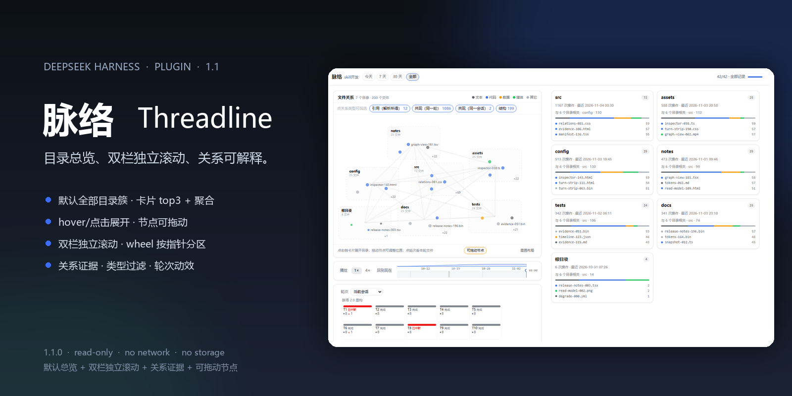
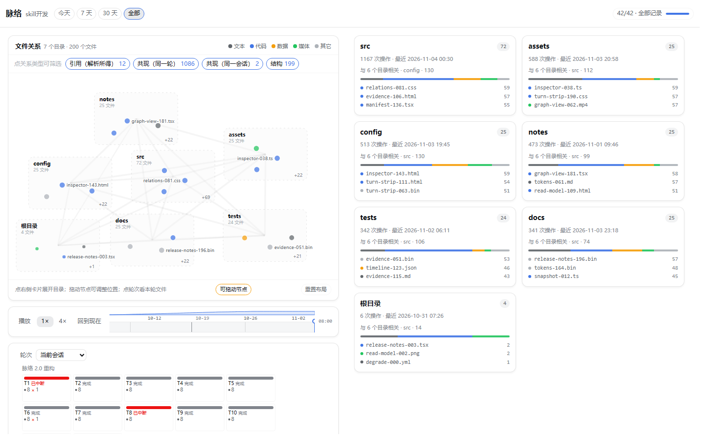
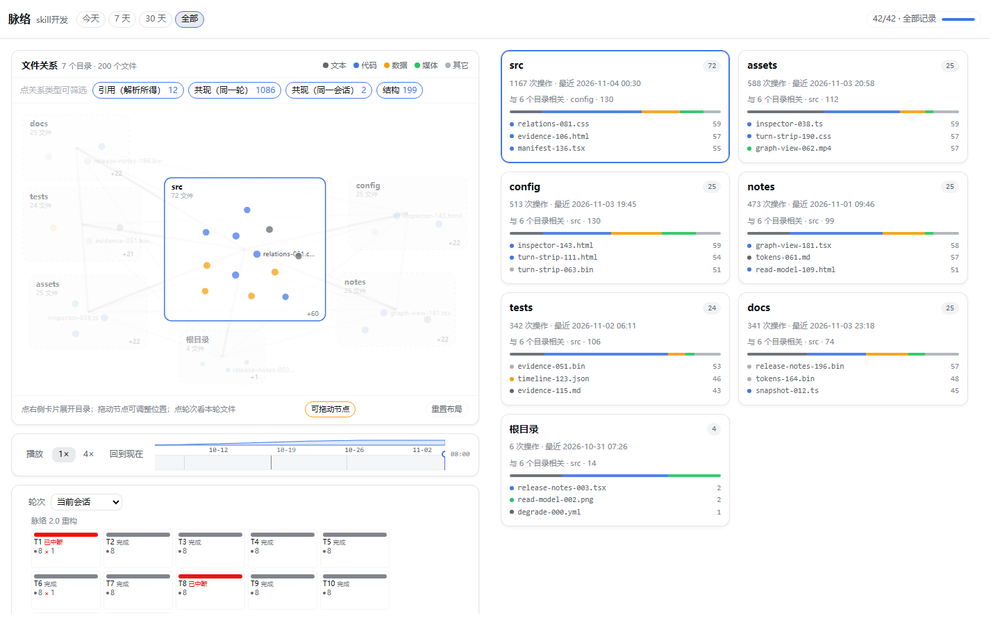
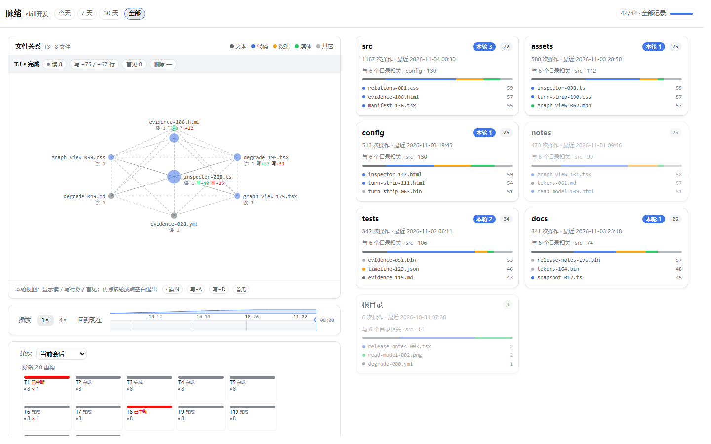

<p align="center">
  
</p>

<h1 align="center">脉络 · Threadline</h1>
<p align="center">永久只读地呈现一个 DeepSeek Harness 工作区实际是怎么长出来的。</p>
<p align="center"><a href="README.md">English</a></p>
<p align="center">
  <a href="https://www.typescriptlang.org/"></a>
  <a href="https://react.dev/"></a>
  <a href="https://github.com/deepseek-ai/deepseek-harness"></a>
  <a href="LICENSE"></a>
  <a href="CHANGELOG.md"></a>
</p>

## 简介

对话记录回答不了这个问题：**这个工作区到底经历了什么，每一轮改动了什么？**

脉络读取 DeepSeek Harness 已经记录下来的内容——会话、子智能体、工具调用、文件操作、命令、后台任务——把它变成当前工作区一张会生长的关系图。被 DSH 触碰过的文件成为节点、按目录分簇；轮次在底部排成一条带；每一个数字都能追溯到某条记录。

它是**永久只读**的：不写工作区、不写会话日志、不改设置、不调用模型、不发出任何外部请求；也没有开始 / 停止 / 重试这类控制面——**刻意一个都没有**。

适合的场景：回到一段很长的会话，或把一个工作区交给别人，想知道这些工作是怎么走过来的。

## 核心特性

- **默认总览星图** —— 左图显示全部目录簇（右卡全部目录；每簇 top3 文件 + `+N` 聚合），不再是单目录钻取；
  簇间只画目录级弱关系，hover/点击卡片或簇才展开 top12 文件，避免数千节点蜘蛛网。
- **双栏独立滚动** —— 指针在左栏只滚左栏、在右栏只滚右栏；页面与 shell 不滚；<960px 回退单页滚动 + 上下堆叠。
- **可交互节点** —— 节点 hover 放大/光晕、相连边提亮、无关 dim；节点可拖动（仅内存，双击/重置恢复）；轮次切换 180–240ms 过渡。
- **关系可解释** —— 同一对文件多条关系按 pair 合并为一条线 + 类型徽标；关系类型 chip 有计数可过滤；
  点击文件/边显示 evidence 浮层；图尾显示已加载会话覆盖。共现不是依赖，权重只表示次数。
- **目录卡关系摘要 / 轮次关系徽标** —— 卡片显示与多少其它目录相关、top partner；轮次块显示本轮文件之间关系数。
- **轮次状态只在可证事实上叠加** —— `读 N` / `写 +A/−D 行` / `首见`；文件级删除/新增不可证，不显示；
  摘要条固定单行，完整语义在 tooltip。
- **每轮影响入口** —— 已定稿助手消息下的图标；点击直接切到「脉络」tab 并聚焦该轮，不打开窗口。
- **`/threadline` 命令** —— 快捷入口：切到「脉络」tab；无弹窗、无第四入口。
- **加载不撒谎** —— detail 未就绪显示骨架 +「正在读取 T{n} 的文件…」；只有 ready 且 0 文件才说“这一轮没有文件操作”。
- **隐私模式 / 列表视图 / 渐进加载 / 永只读** —— 路径/标题可掩码；键盘可达；未加载/失败/观测不到显式标注。

## 安装

前提：DeepSeek Harness **0.2.2-rc.1** 或更新版本（桌面版或 Web 版 profile）。

从 npm 安装：

```text
插件管理 → Add plugin → dsh-plugin-control-your-development@1.1.0
```

或直接装进 profile：

```bash
dsh plugin add dsh-plugin-control-your-development@1.1.0 --profile desktop
```

装完刷新页面（客户端代码生效）或重启 DSH（宿主代码生效）。

> DSH 已安装的插件不会自动更新。升级 = 卸载后重装，这是 DSH 的行为，不是脉络的限制。

## 使用方式

打开任意会话，点对话页的 **脉络 / Threadline** tab（在「对话」「轨迹」之后）。tab 占满会话区域，左右栏各自滚动。

<p align="center">
  
</p>

- 默认看到全部目录簇；点/hover 右侧目录卡或左图簇展开内部文件，点击 pin/收起。
- 点文件节点看关系；点关系类型 chip 过滤；拖动节点调整位置，双击或「重置布局」恢复。
- 点轮次查看该轮文件、读/写行/首见与关系；再点或 Esc 回总览。
- 时间轴把工作区按时间回放；范围有 **今天 / 7 天 / 30 天 / 全部**。
- `/threadline` 命令 = 跳 tab；每轮「影响」图标 = 跳 tab 并聚焦该轮。

<p align="center">
  
</p>

<p align="center">
  
</p>

脉络只读当前会话所属的**那一个工作区**；不汇总其它工作区、profile 或机器。

## 配置

不需要。没有配置文件、没有设置项、不保存偏好、不落任何缓存产物——所有筛选、选择与时间范围都只在内存里，刷新即重置。它唯一需要的就是它已经在的那个工作区。

## 项目结构

```text
plugin/
  src/shared/      事件归约、关系引擎、引用解析
  src/host/        只读扫描、内存索引、本地只读路由
  src/client/      数据层、界面、三个入口
  lib/             DSH 实际加载的构建产物（不要手改）
  tests/           单元、集成与截图夹具
```

## 发布

当前版本：**面板插件 v1.1.0**（正式版）。

每个版本改了什么见 [CHANGELOG.md](CHANGELOG.md)，可安装的版本见 [Releases](https://github.com/HaoyanZhang123/dsh-plugin-control-your-development/releases)。

## 许可证

[MIT](LICENSE)
